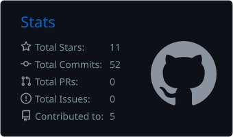
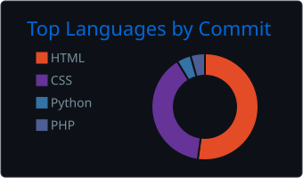

 

## 👨‍💻 About Me

<!-- GANTI: sesuaikan bio ini dengan ceritamu sendiri -->
Hi, I'm **Ahmad Rifqi** — a 5th-semester Informatics Engineering student at **Universitas Muhammadiyah Cirebon**, based in Indonesia 🇮🇩.

I enjoy turning real-world needs into clean, reliable web applications, from database design to a polished user interface.

- 🎓 Studying Informatics Engineering (Teknik Informatika)
- 💻 Building web apps with PHP, Laravel, CodeIgniter, and JavaScript
- 🤝 Open to internships, collaboration, and freelance projects
- 📫 Reach me through the contact links below

 

## 🛠️ Tech Stack

**Frontend** 

  

**Backend & Database** 

  

**Tools & Design** 

 

## 🚀 Featured Projects

<!-- GANTI: isi nama repo, deskripsi, dan teknologi untuk tiap proyek. Hapus <td> yang tidak dipakai. -->

<table>
  <tr>
    <td width="50%" valign="top">
      <h4><a href="https://github.com/ahmdrifqi16/NAMA-REPO-1">NAMA-REPO-1</a></h4>
      
GANTI: deskripsi singkat proyek (1 kalimat).

      
    </td>
    <td width="50%" valign="top">
      <h4><a href="https://github.com/ahmdrifqi16/NAMA-REPO-2">NAMA-REPO-2</a></h4>
      
GANTI: deskripsi singkat proyek (1 kalimat).

      
    </td>
  </tr>
  <tr>
    <td width="50%" valign="top">
      <h4><a href="https://github.com/ahmdrifqi16/NAMA-REPO-3">NAMA-REPO-3</a></h4>
      
GANTI: deskripsi singkat proyek (1 kalimat).

      
    </td>
    <td width="50%" valign="top">
      <h4><a href="https://github.com/ahmdrifqi16/NAMA-REPO-4">NAMA-REPO-4</a></h4>
      
GANTI: deskripsi singkat proyek (1 kalimat).

      
    </td>
  </tr>
</table>

 

## 📊 GitHub Stats

<!-- Kartu di bawah dibuat otomatis oleh workflow .github/workflows/profile-cards.yml -->

  
  

 

  

 

## 🤝 Let's Connect

<!-- GANTI: isi URL LinkedIn dengan profil LinkedIn-mu -->

  
  
  
  
  

 

  
  

